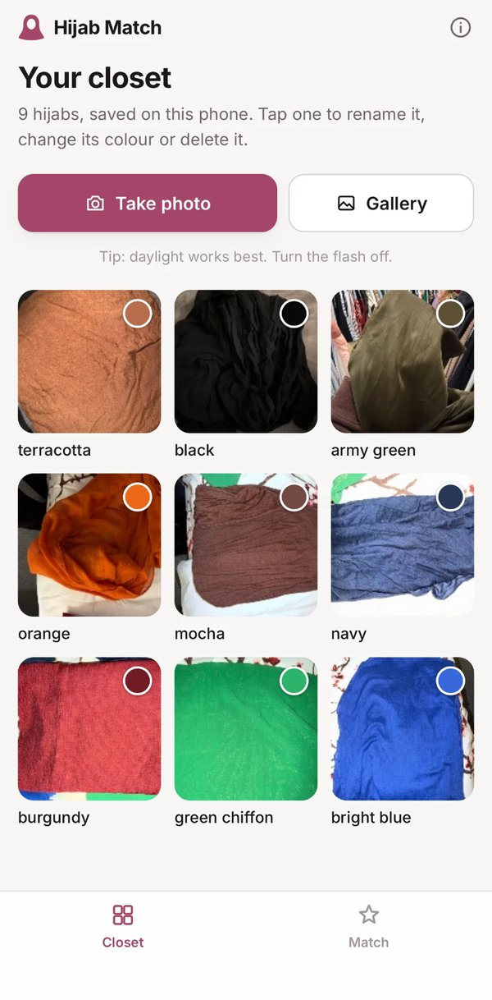
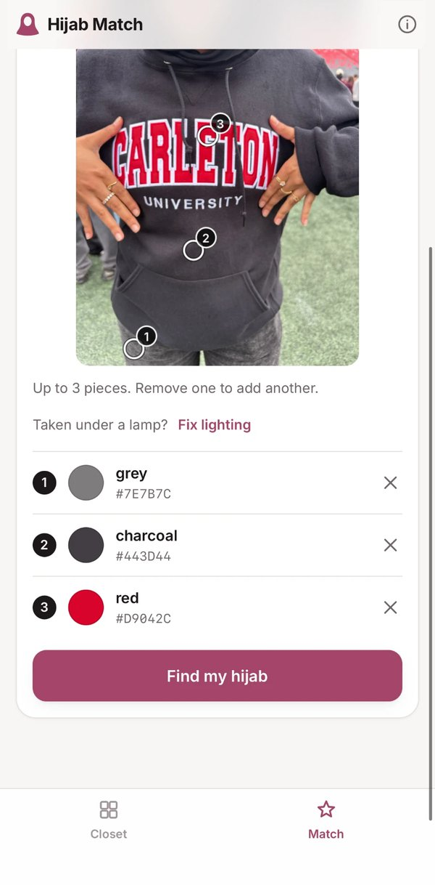
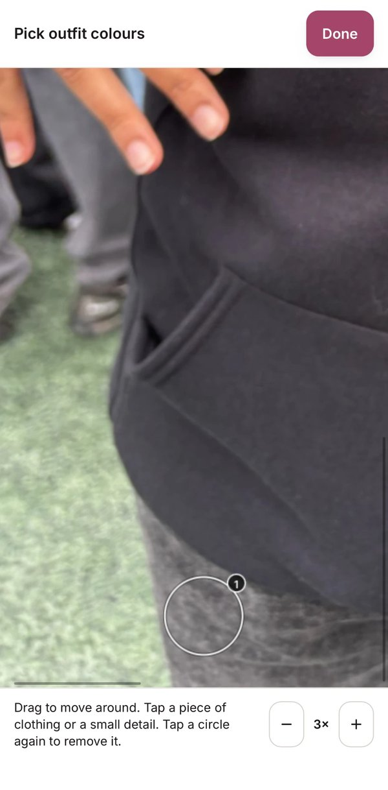
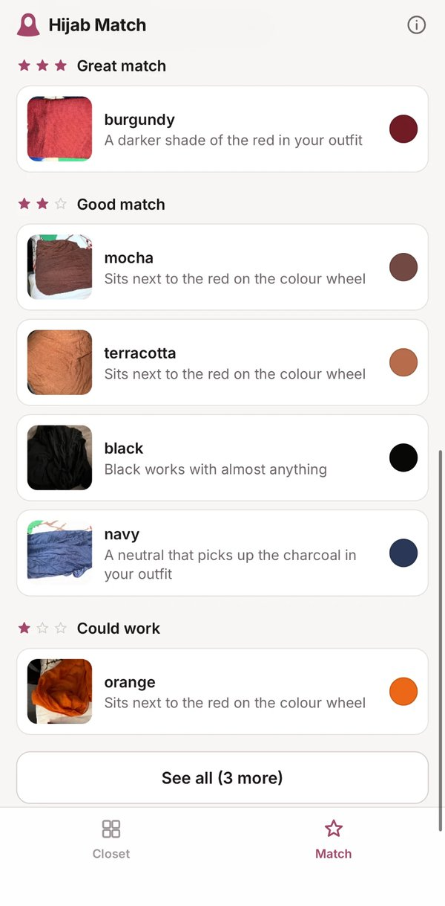

# 
Hijab Match

Find the hijab in your own closet that goes with your outfit. Photograph the outfit, tap its colours, and Hijab Match ranks your hijabs with a reason for each. It's a phone-first web app with no account, and every photo stays on your phone.

**Try it:** <https://shanzayc.github.io/hijab-match/> (best on a phone). To open it like an app, add it to your home screen (Safari: Share, then Add to Home Screen).

## Why I built this

Growing up, I always wore a black hijab. It went with everything, but it was also a way to hide. I built Hijab Match for girls who want to wear more than black and feel confident doing it: it finds the hijab in your own closet that pulls an outfit together, and sometimes suggests a colour you wouldn't have tried.

## How it works

### 1. Build your closet

Photograph each hijab once and tap the fabric. The app reads its colour and suggests a name, which you can change.



### 2. Pick colours from your outfit

Photograph an outfit and tap up to 3 pieces. For a tiny detail, like a dot in a pattern, zoom in and tap it there.

<p>
  
  &nbsp;
  
</p>

Photo taken under a lamp? **Fix lighting** corrects the colours: tap something white in the photo.

### 3. See your matches

Every hijab is scored against the outfit with colour rules (same colour, lighter or darker shade, neighbouring, bold contrast, neutrals that echo the outfit) and grouped into 3, 2 or 1 stars, each with a reason.



Everything runs in the browser, so photos never leave the phone.

## Does it work?

I tested it in two rounds with my own 15 hijabs. Before looking at the results, I wrote down which hijab I'd actually wear, then judged the app's top pick.

- The top pick passed in all 17 outfit tests.
- After I tuned the rules from round 1, the top pick was the one I'd have chosen myself for 7 of 8 outfits.
- Hijabs in the results that I wouldn't wear fell from about 3 per outfit to under 1.

The full results, and what I changed because of them, are in [TESTING.md](TESTING.md).

## More

- [DECISIONS.md](DECISIONS.md): the reasoning behind the main choices
- [TESTING.md](TESTING.md): how I tested it, what I found, and what changed
- [TEST-LOG.md](TEST-LOG.md): my raw test notes for every outfit, as I wrote them
- [Privacy policy](https://shanzayc.github.io/hijab-match/privacy.html) and [terms of use](https://shanzayc.github.io/hijab-match/terms.html)

## Run it yourself

The app uses JavaScript modules, so serve it over HTTP rather than opening the file:

```bash
python3 -m http.server 5174
```

Then open <http://localhost:5174>. The colour maths and matching rules have automated tests, including the outfits from real-world testing:

```bash
node --test tests/*.test.mjs
```

## Contact

Made by Shanzay Chaudhry. I'd love to hear what you think.

- Email: [shanzayc33@gmail.com](mailto:shanzayc@outlook.com)
- LinkedIn: [linkedin.com/in/shanzaychaudhry](https://www.linkedin.com/in/shanzaychaudhry)
- GitHub: [@shanzayc](https://github.com/shanzayc), or [open an issue](https://github.com/shanzayc/hijab-match/issues) for bugs and ideas
